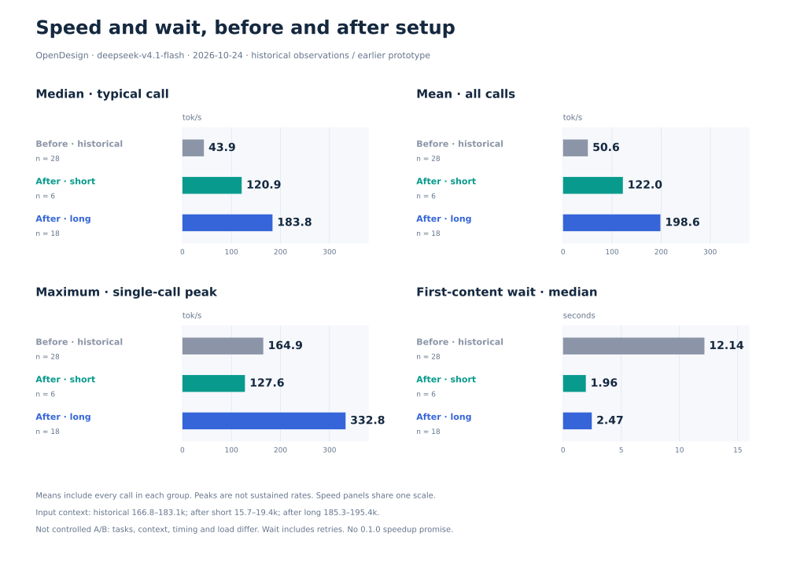
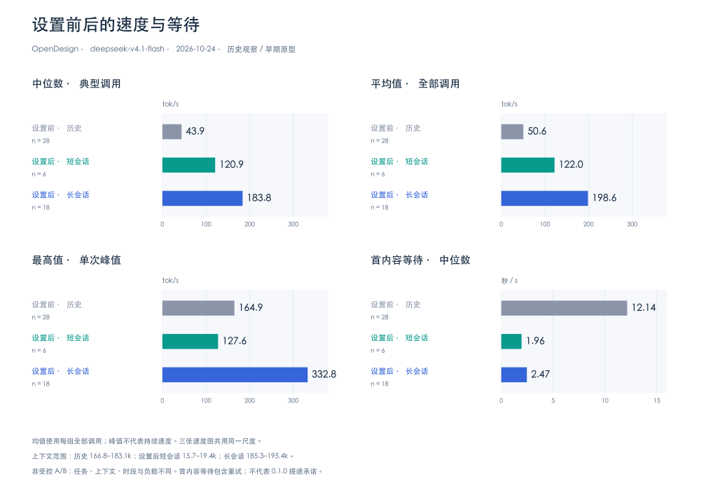
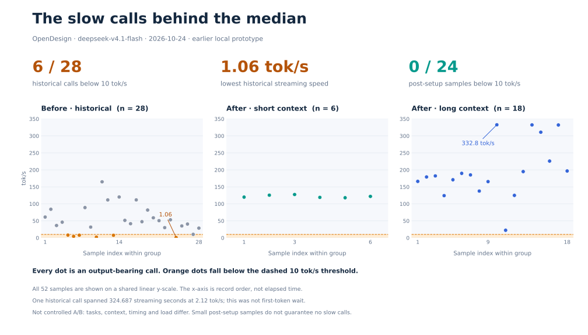
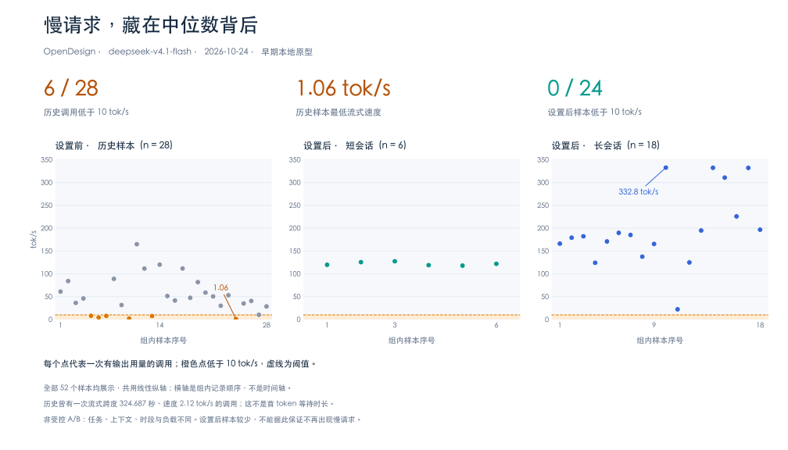

# Historical routing case study

[English README](../../README.md) · [中文 README](../../README.zh-CN.md) · [Metric-only dataset](case-study.json)

## README overview / README 主图

The README compares the median of all 28 historical call rates (**43.88 tok/s**) with the median of all 24 post-setup call rates (**168.57 tok/s**). The 6 short-context and 18 long-context rows are pooled before computing the median; subgroup medians are not averaged. Post-setup arithmetic mean is **179.4383 tok/s**, and maximum is **332.75 tok/s**. Pooling simplifies presentation but does not make the workloads comparable or establish causation.

README 仅保留整体中位数两根柱子：设置前 43.88、设置后 168.57 tok/s。设置后 24 个原始速度值合并计算，不是对两个分组中位数求平均。各组均值、峰值、等待时间及全部散点保留如下。

## What the chart represents

Recorded on 2026-10-24 using DSH 0.2.1-rc.3 and OpenDesign / deepseek-v4.1-flash. These are observations from an earlier local domain-routing prototype, not benchmarks of the 0.1.0 package.

| Group | Output-bearing calls | Input-token range | Median stream tok/s | Median first-content wait |
| --- | ---: | ---: | ---: | ---: |
| Before: historical sample | 28 | 166,778–183,099 | 43.88 | 12.1405 s |
| After: short-context text tasks | 6 | 15,690–19,419 | 120.92 | 1.9585 s |
| After: long-context tool tasks | 18 | 185,317–195,419 | 183.755 | 2.4695 s |

Input range sums uncached input and cache-read counts. Each row in the dataset represents a model response, not a complete user turn. The long-context post-setup group covers four complete consecutive turns with multiple model calls; the short group covers six text-only turns.

## Extended post-setup sample

The long-context group was expanded from 8 to 18 calls by including four consecutive complete turns in the same historical session (18:58–19:40, Asia/Shanghai, 2026-10-24). The first eight rows were reconstructed from the raw events and match the earlier dataset exactly. They are replaced, not added twice. Every output-bearing call in those four turns is retained, including the 22.32 tok/s call and all six calls in the last turn. An earlier prose report stopped after the second call of that last turn and listed only 14 calls.

Across the 18 long-context calls: median **183.755**, arithmetic mean **198.5772**, minimum **22.32**, maximum **332.75 tok/s**. The mean gives equal weight to every per-call rate; it is not total tokens divided by total stream duration and is not an average of only the fastest calls. Very short responses and client buffering can affect per-call rates. The peak is not sustained server throughput.

Historical group membership stays unchanged at 28 calls; this is a selected historical case study, not the entire earlier session or a causal comparison. The short-context group stays separate at 6 calls.

## Speed and wait comparison / 速度与等待对比

中文图表

## Slow-call distribution

Using a descriptive threshold of **strictly below 10 tok/s**, the historical group contains **6/28** slow calls (21.4% of recorded output-bearing calls): 8.08, 4.48, 7.85, 2.12, 7.58 and 1.06 tok/s. The short-context and long-context post-setup groups contain **0/6** and **0/18**, respectively. This is not an error rate, an SLA threshold, or evidence that slow calls cannot recur.

The slowest historical sample is 1.06 tok/s with a 185.091-second streaming span. A different sample spans 324.687 streaming seconds at 2.12 tok/s; these values must not be combined into one call. Streaming span is not first-content wait or complete turn duration.

The scatter plot includes all 52 rows, without filtering or connecting lines. All panels share a linear y-axis starting at zero; each x-axis numbers records within its own group, not comparable timestamps or paired tasks. Orange points identify calls below 10 tok/s. No worst-before / best-after speedup ratio is calculated.

中文逐次调用图

## Calculation and limitations

- The chart shows the median, arithmetic mean and maximum of per-call output-token rates, plus median first-content wait. All three speed panels share one axis scale. The mean is not total tokens divided by total time; the maximum is not a sustained rate.
- Streaming duration runs from the first recorded stream event to the last. It includes pauses within that span, but excludes the initial wait and subsequent tool execution.
- First-content wait runs from session step/start to the first recorded text/tool-content event. It includes failed-attempt/retry waiting. This boundary differs from the newer in-plugin observer, which starts at model-stream consumption.
- Only assistant messages with reported output usage appear as rows. Failed/incomplete attempts are not separate samples; their waiting can affect recorded calls. These data must not be used to claim a success rate.
- Historical requests were not verified as a clean direct-route control. After setup, the Desktop backend was observed connecting to the local proxy during verification.
- This was not randomized or contemporaneous A/B. Tasks, output lengths, context, caching, nodes and service load differed. Short tool-call output may produce different token rates from longer prose.
- No answer-quality, billing, cross-platform or long-term-stability comparison was performed.

The chart presents the observed experience, not a causal speedup estimate. No improvement percentage or guaranteed token rate is claimed.

## Reproduce the figures

The JSON contains only public model identifiers and numeric metrics, with no session IDs, prompts, responses, credentials, internal hostnames or machine paths. It is a sanitized numeric extract of local session-log analysis; raw private logs are not published. Reproduction verifies chart calculations, not the original network conditions.

From the repository root, with Python and matplotlib 3.10.3:

    python3 -m pip install matplotlib==3.10.3
    python3 scripts/render-performance.py

Set CHART_CJK_FONT to a Chinese font file if the script cannot find a supported local font. The script emits English and Chinese SVG/PNG figures under docs/images. Matplotlib is an optional documentation dependency, not a plugin runtime dependency.

## 中文说明

这是 28 次历史调用、6 次设置后短会话调用和 18 次设置后长会话调用的观察性对照。历史组不是已逐条验证的纯直连控制组，数据来自旧本地原型，不是 0.1.0 基准。图中首内容等待包含重试等待；未完整输出的失败尝试没有单独成为样本。上下文、任务、时段、缓存与节点负载不同，因此不能将速度差异全部归因于插件，更不能据此承诺长期稳定或固定提速幅度。

逐次调用散点图保留全部 52 条样本：历史组低于 10 tok/s 的调用为 6/28，设置后为 0/6 和 0/18。最低 1.06 tok/s 与流式跨度 324.687 秒属于不同调用；后者速度为 2.12 tok/s。这个阈值仅用于描述样本，不代表故障率或服务保证。

本次将设置后长会话扩展至连续四个完整轮次的 18 次调用，原 8 条逐项复核一致并被替换，不重复累加。保留 22.32 tok/s 的慢调用及最后一轮的全部六次调用。18 次的算术平均为 198.5772 tok/s，中位数为 183.755，最高为 332.75；平均值不是仅取最快几次，也不是按 token 总量和耗时汇总的吞吐率。
